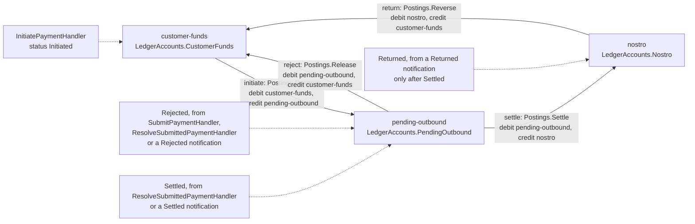
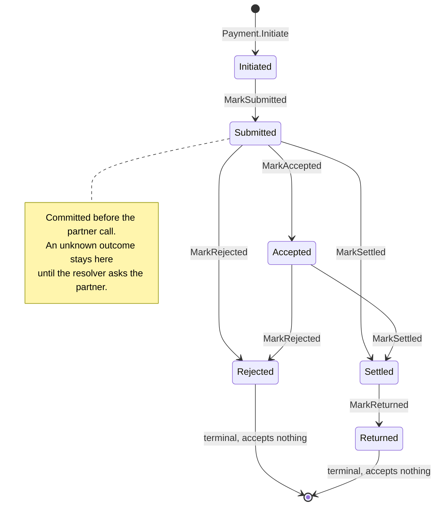
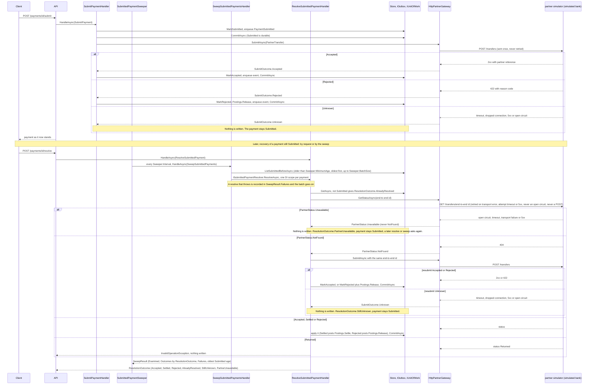
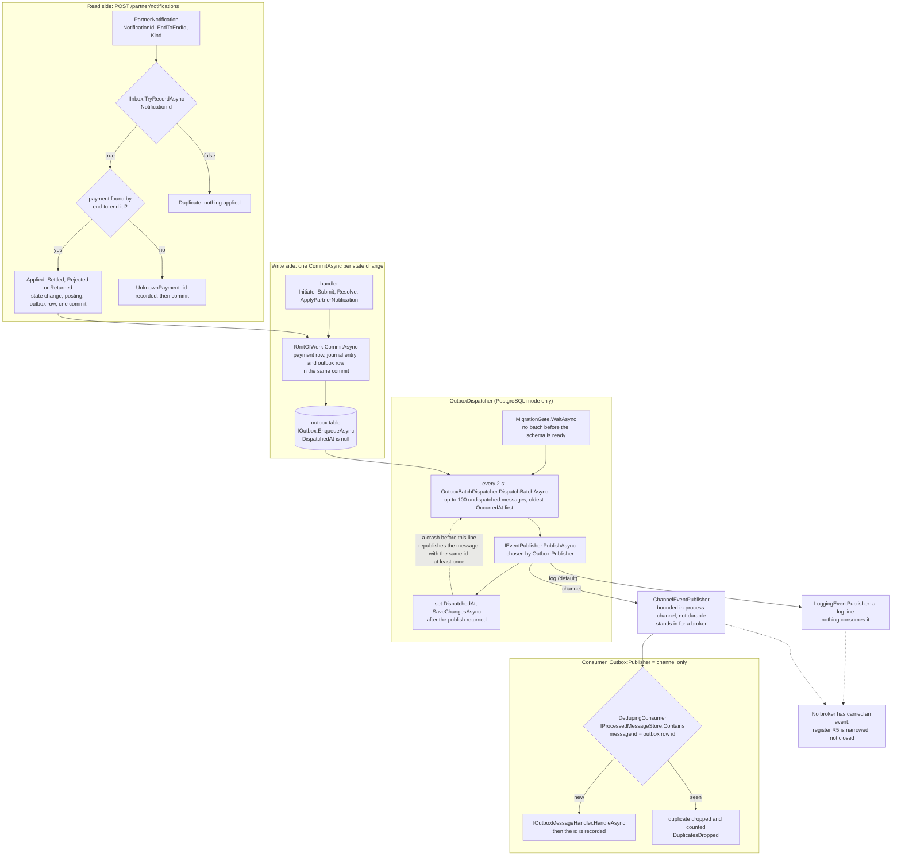
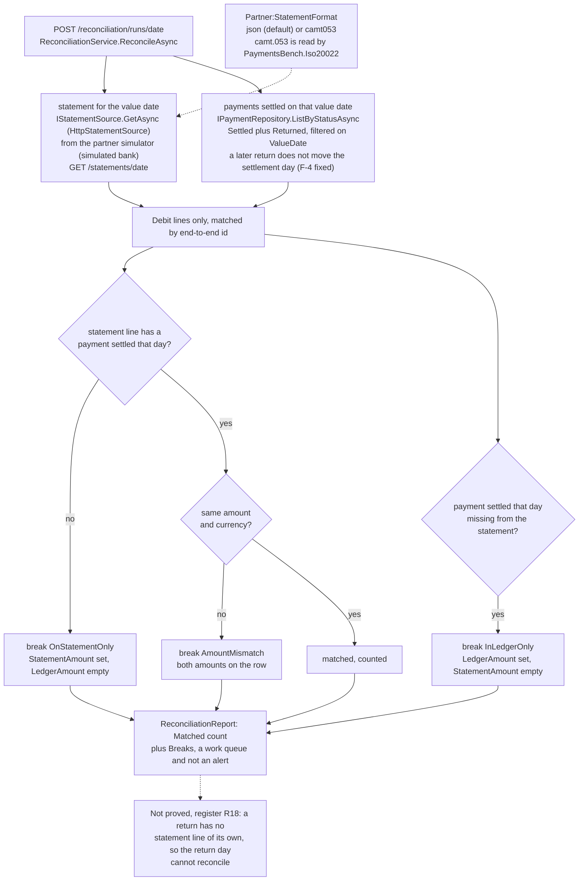
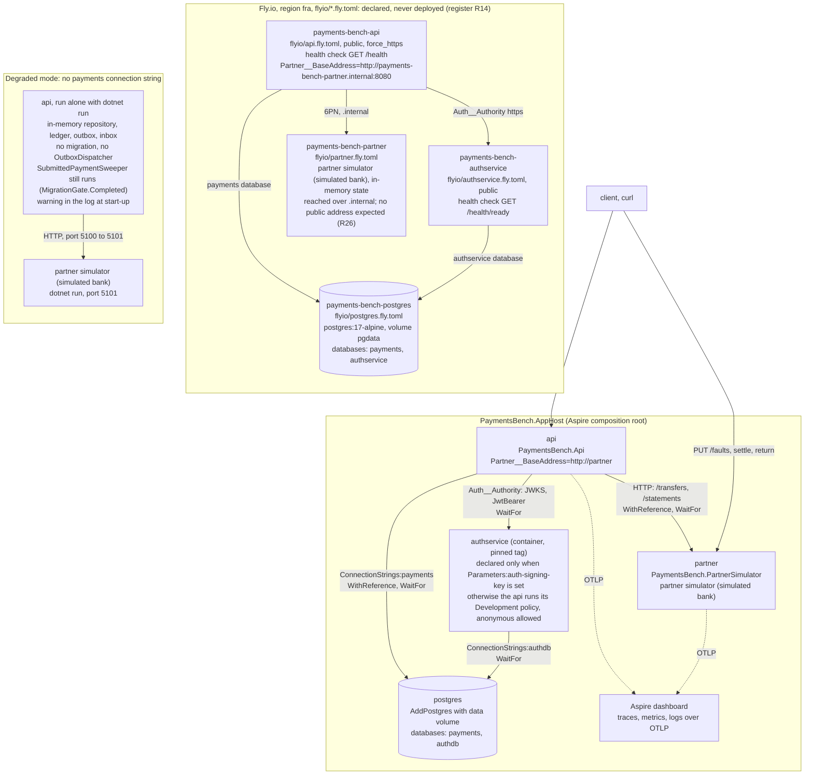

# Diagrams

Every structural claim in this repository as a picture, in Mermaid, rendered by GitHub with no build step.
Each diagram names the source it reflects; when the code and a picture disagree, the code is right and
the picture is a bug. Nothing here talks to a real bank: the partner is the simulator, drawn as
"partner simulator (simulated bank)".

Each diagram exists twice, byte-identical: inline here (the form GitHub renders) and as a file in
[`docs/diagrams/`](diagrams/) (the form that can be rendered to PDF). The section id is the join key
(`### A1.` owns `a1-*.mmd`), and `npm run lint:diagrams` ([`scripts/check-diagrams.mjs`](../scripts/check-diagrams.mjs))
fails when they differ.

## The diagrams

### A1. Money path

Where customer money sits and which payment event moves it: reserve on initiation, release on rejection, settle to the nostro, reverse on return. The accounts are `LedgerAccounts` and the movements are the four entries in `Postings` (`src/PaymentsBench.Domain/Ledger/Postings.cs`).

### A2. Payment state machine

The six `PaymentStatus` values and every move `PaymentTransitions` allows, nothing more. `Rejected` and `Returned` are terminal. Source: `src/PaymentsBench.Domain/Payments/PaymentTransitions.cs`.

### A3. Submit and resolve

`Submitted` is committed before the partner call; the three submit outcomes (Accepted, Rejected, Unknown) and the resolver, which asks by end-to-end id and resubmits, with the same id, only on `PartnerStatus.NotFound`. An unreachable partner is `PartnerStatus.Unavailable` (`ResolutionOutcome.PartnerUnavailable`), never `NotFound`; a resubmit with no answer is `ResolutionOutcome.StillUnknown`. The resolver runs on request (`POST /payments/{id}/resolve`) and on a schedule (`SubmittedPaymentSweeper`, then `SweepSubmittedPaymentsHandler`). The partner is the simulated bank. Source: `SubmitPayment.cs`, `ResolveSubmittedPayment.cs`, `SweepSubmittedPayments.cs`, `HttpPartnerGateway.cs`, `PartnerResilience.cs` and `src/PaymentsBench.Infrastructure/Sweeping/`.

### A4. Outbox and inbox

Events are written in the same commit as the state change; `OutboxDispatcher` (after `MigrationGate`) publishes at least once through the `IEventPublisher` that `Outbox:Publisher` selects: `log` (a log line, the default) or `channel` (a bounded in-process channel read by `DedupingConsumer`, which drops a repeated message id). Register R5 is narrowed, not closed: no broker has carried an event. Partner notifications are deduplicated by notification id in the inbox. Source: `OutboxDispatcher.cs`, `OutboxBatchDispatcher.cs`, `OutboxRegistration.cs`, `DedupingConsumer.cs`, `MigrationGate.cs` and `ApplyPartnerNotification.cs`.

### A5. Reconciliation

A value date's statement against the payments settled on that value date, whatever happened to them afterwards (`Settled` and `Returned`, finding F-4 fixed): matches are counted, and the three `BreakKind` values become a work queue. The statement is JSON or camt.053 as `Partner:StatementFormat` says. A return has no statement line of its own (register R18). Source: `src/PaymentsBench.Application/Reconciliation/ReconciliationService.cs` and `src/PaymentsBench.Infrastructure/Partner/HttpStatementSource.cs`.

### A6. Delivery topology

What `AppHost` composes (PostgreSQL, the simulated partner, the API, authservice when `Parameters:auth-signing-key` is set, the Aspire dashboard over OTLP), the Fly.io estate as `flyio/` declares it (declared, never deployed: register R14) and the degraded in-memory mode when there is no `payments` connection string. Source: `src/PaymentsBench.AppHost/AppHost.cs`, `flyio/*.fly.toml` and `InfrastructureRegistration.cs`.

